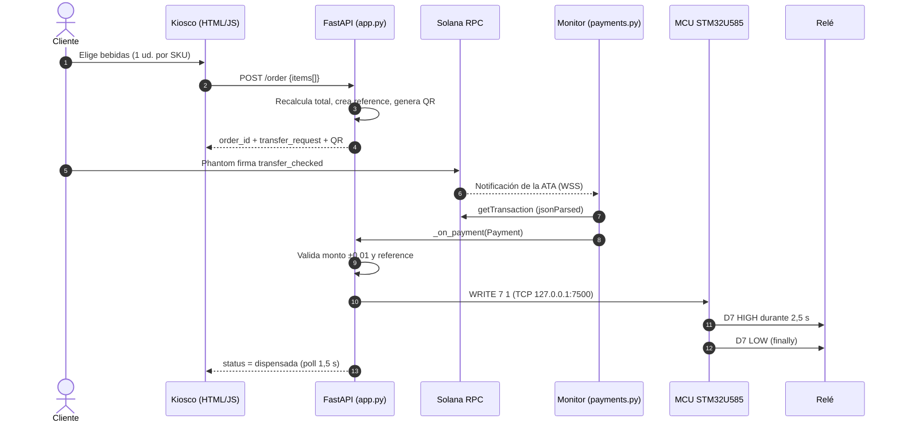
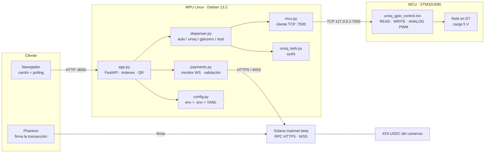

# 🥤 Vending Solana USDC — Arduino UNO Q

[](https://www.python.org/)
[](https://fastapi.tiangolo.com/)
[](https://solana.com/)
[](https://www.circle.com/usdc)
[](https://docs.arduino.cc/hardware/uno-q)
[](https://www.debian.org/releases/trixie/)
[](LICENSE)

**Máquina expendedora que cobra USDC en Solana y dispensa con un relé gobernado por el MCU de una Arduino UNO Q.** Del escaneo del QR al clic del relé, sin monedas, sin datáfono y sin clave privada en la placa.

> Proyecto completo y funcional: firmware del STM32U585, backend FastAPI, monitor de pagos por WebSocket, kiosco web, despliegue por ADB y unidades systemd. Probado con pagos reales en mainnet-beta y documentado con sus límites a la vista.

---

## Tabla de contenidos

1. [Qué es y qué problema resuelve](#1-qué-es-y-qué-problema-resuelve)
2. [Por qué Arduino UNO Q y no una Raspberry Pi](#2-por-qué-arduino-uno-q-y-no-una-raspberry-pi)
3. [Principio de funcionamiento](#3-principio-de-funcionamiento)
4. [Arquitectura de software](#4-arquitectura-de-software)
5. [Cómo se construyó](#5-cómo-se-construyó)
6. [Hardware, software y dependencias](#6-hardware-software-y-dependencias)
7. [Instalación y despliegue](#7-instalación-y-despliegue)
8. [Catálogo](#8-catálogo)
9. [Configuración](#9-configuración)
10. [API HTTP](#10-api-http)
11. [Operación de la interfaz](#11-operación-de-la-interfaz)
12. [Seguridad](#12-seguridad)
13. [Rendimiento y latencia](#13-rendimiento-y-latencia)
14. [Solución de problemas](#14-solución-de-problemas)
15. [Limitaciones conocidas](#15-limitaciones-conocidas)
16. [Advertencias](#16-advertencias)
17. [Referencias](#17-referencias)
18. [Licencia y autor](#18-licencia-y-autor)

---

## 1. Qué es y qué problema resuelve

Una máquina expendedora tradicional exige monedas, billetes o un lector con contrato de adquirencia: fricción física y costo operativo. Aquí el camino es el opuesto: **el cliente paga con una stablecoin, el comerciante recibe el importe en su wallet y la máquina solo cierra un relé cuando el dinero ya está confirmado en la cadena**.

La implementación es una máquina de ocho bebidas:

- **Pago:** USDC (SPL Token) sobre Solana mainnet-beta, mediante un *Transfer Request* de **Solana Pay** en un QR.
- **Validación:** el backend vigila la ATA del comercio por WebSocket y reconcilia por RPC. Antes de dispensar comprueba destino, monto y `reference`.
- **Dispensado:** pulso de 2,5 s en **D7**, ejecutado por el **MCU STM32U585**, que gobierna un relé optoacoplado.
- **Interfaz:** web de kiosco con carrito (una unidad por SKU), total recalculado en servidor, QR, cronómetro de 60 s y polling cada 1,5 s.
- **Operación:** la placa solo conoce la *pubkey* del comercio y deriva la ATA. Firmar o reembolsar se hace desde un equipo seguro.

**Qué NO es.** No es un terminal certificado, no gestiona *chargebacks*, no repone stock, no persiste órdenes ni sustituye a un datáfono homologado. Es una implementación de referencia, auditada, sobre hardware real.

**Estado verificado en la unidad de prueba (octubre de 2026):**

| Aspecto | Estado |
|---|---|
| Servicio systemd | `active`, arranca tras reinicio, relé en OFF al inicio |
| Backend GPIO | `backend: unoq`, `available: true`, `stub: false` |
| Pagos reales mainnet | 3 validados: 1,50019 / 1,000145 / 0,900125 USDC |
| Transacción fallida | Ignorada correctamente (no dispensa) |
| Flujo simulado completo | Orden → pago simulado → pulso real D7 2,5 s → `dispensada` |
| Red de la unidad | WiFi en RMA por fallo de hardware; RPC inalcanzable en esa placa |
| E2E en devnet | **No ejecutado**: sin ruta a internet y faucet agotado (HTTP 429) |

---

## 2. Por qué Arduino UNO Q y no una Raspberry Pi

El proyecto nació como `vending-solana-v2` sobre Raspberry Pi y funcionaba en producción. La migración interesaba por evaluar una placa **industrial, con Linux y microcontrolador en el mismo PCB**, y medir el costo de mover un servicio ya probado.

| Dimensión | Raspberry Pi (v2) | Arduino UNO Q (este proyecto) |
|---|---|---|
| Cómputo | BCM2712, 4 núcleos, 4–8 GB RAM | MPU Qualcomm QCM2290, aarch64, 1,7 GiB RAM |
| Sistema | Raspberry Pi OS, Python 3.11 | Debian 13.2 trixie, Python 3.13.5 sin `pip`/`ensurepip` |
| GPIO | `gpiozero` + `lgpio` directo al SoC | **No hay GPIO del header en Linux**: se llega por el MCU |
| Tiempo real | Linux agenda el pulso | MCU STM32U585 (Zephyr) ejecuta `WRITE`/`PWM` sin jitter |
| Pin del relé | BCM17 | **D7** (pin lógico 7 del header) |
| LEDs de estado | 3 GPIOs + resistencias | 3 LEDs de placa por sysfs: `green:user`, `blue:user`, `red:user` |
| Despliegue | `scp` + systemd por SSH | `tar` por **ADB/USB** + `adb shell` + systemd |
| Conectividad | WiFi/LTE (módem Teltonika) | WiFi WCN3990 + Ethernet; unidad de prueba con WiFi en RMA |
| Almacenamiento | microSD (frágil) | eMMC de 9,8 GB (4,0 GB libres) |
| Madurez del ecosistema | Muy alta | Joven: documentación y tooling en evolución |

**Lo que la UNO Q hace mejor.** El pulso no compite con el recolector de basura ni con el scheduler: lo ejecuta un MCU dedicado y el Linux solo envía un comando ASCII. Los LEDs vienen integrados y el despliegue por USB funciona sin red, justo la situación de las pruebas.

**Lo que hace peor.** El header **no está expuesto al Linux**: `gpiochip1` y `gpiochip2` son pinctrl internos del MPU (LEDs y botones), no el conector, así que `libgpiod` no sirve para el relé. Tampoco existe `/dev/ttyACM0` dentro de la placa y `/dev/ttyHS1` está tomado por `arduino-router`; la única vía practicable fue su monitor TCP en `127.0.0.1:7500`. Además, la imagen no trae `pip`, el ecosistema es joven y la unidad desarrolló un fallo de hardware en el WiFi (documentado en el informe interno de RMA, que no se publica).

**Conclusión honesta:** para servir una web y cerrar un relé, la UNO Q alcanza y aporta aislamiento del tiempo real. Para cámaras, visión o GPIO maduro, la Pi sigue siendo conservadora. El mismo backend corre en ambas (`requirements.txt` / `requirements-pi.txt`).

---

## 3. Principio de funcionamiento

### 3.1 Recorrido del pago

1. **Carrito.** La web muestra ocho bebidas. El carrito admite una unidad por SKU; no hay cantidades ni stock.
2. **Orden.** `POST /order` recibe solo los SKU. El backend **ignora cualquier precio del navegador**, recalcula el total desde `catalog.yaml`, genera `order_id` y una `reference` única (`Pubkey.new_unique()`) y construye el *transfer request*.
3. **QR.** Se genera un PNG con `qrcode` (corrección M, borde 4) embebido en base64. La URL es `solana:<merchant>?spl-token=<mint>&reference=<ref>`: **sin `amount` ni metadatos**, por una decisión explicada en 3.3.
4. **Pago.** El cliente escanea con Phantom, **digita el monto exacto** y firma una `transfer_checked` del SPL Token Program hacia la ATA del comercio. La `reference` viaja entre las cuentas de la transacción.
5. **Detección.** `payments.py` mantiene `account_subscribe` sobre la ATA. Al recibir una notificación pide la transacción (`jsonParsed`), resuelve las cuentas —incluidas las de lookup tables v0— y localiza la transferencia hacia la ATA.
6. **Validación.** Descarta transacciones con `meta.err`, exige monto dentro de ±0,01 USDC y `reference` de una orden pendiente. Si cuadra, marca `pagada`.
7. **Dispensado.** `dispenser.py` enciende el LED azul, envía `WRITE 7 1`, espera 2,5 s, envía `WRITE 7 0`, apaga el LED y marca `dispensada`. Con varios productos repite el pulso con 1 s de pausa.
8. **Confirmación.** La UI consulta `GET /order/{id}` cada 1,5 s y redirige a la pantalla de confirmación.

### 3.2 Secuencia



### 3.3 Por qué el QR no lleva el monto

La especificación permite `amount` en unidades base. En teoría, `amount=1000000` debería mostrar 1,00 USDC. En la práctica, **algunas versiones de Phantom interpretan mal ese parámetro y muestran cifras desproporcionadas** (1.000.000 o 150.000 en lugar de 1,50). Se emite el QR sin `amount` ni metadatos: el monto queda en pantalla y el usuario lo digita. Es **deliberado**; también implica que puede pagar de más o de menos, y por eso existen la tolerancia y `monto_incorrecto`.

---

## 4. Arquitectura de software

### 4.1 Componentes



### 4.2 Módulos y responsabilidades

| Archivo | Rol | Piezas clave |
|---|---|---|
| `app.py` | HTTP y orquestación de órdenes | `POST /order`, `_on_payment`, `_dispatch_dispense`, `_expiry_sweeper`, `/healthz`, endpoints de prueba |
| `payments.py` | Detección y validación de pagos | `build_transfer_request`, `validate_payment_tx`, `PaymentMonitor` (WS + reconciliación + failover) |
| `dispenser.py` | Abstracción de hardware | Backends `unoq`, `gpiozero`, `stub`; `dispense`, `set_led`, `cleanup`; fail-safe OFF |
| `mcu.py` | Puente TCP al MCU | `McuLink`, `write_pin`, `read_pin`, `read_analog`, `pwm`, `pulse`, `probe` |
| `unoq_leds.py` | LEDs de placa | `BoardLed`, `BoardLeds`, `trigger`, `brightness` |
| `wallet.py` | Identidad del comercio | `load_merchant`, `derive_ata`, `get_or_create_ata` |
| `config.py` | Configuración jerárquica | `Config`, `load_config`, `ENV_MAP`, coerción de tipos |

La regla es simple: **`app.py` no habla con la blockchain ni con el GPIO; delega**. `payments.py` no sabe de HTTP, `dispenser.py` no sabe de pagos, `mcu.py` solo de pines. Esa separación permitió migrar desde Raspberry Pi cambiando un backend y sin tocar la lógica de pagos.

### 4.3 Estados de una orden

`pendiente` → `pagada` → `dispensada`; desde `pendiente` también se puede ir a `expirada` (60 s) o `cancelada`. Si el monto no coincide: `monto_incorrecto`. Si el GPIO falla después de cobrar, queda en `pagada` con LED rojo.

- Las órdenes viven **en memoria** (`ORDERS`, `ORDERS_BY_REFERENCE`, `UNMATCHED_PAYMENTS`); un reinicio las pierde.
- El barrido de expiración corre cada 5 s y libera la `reference`, sin borrar la orden.
- Un pago posterior a cancelar o expirar queda en `UNMATCHED_PAYMENTS` y requiere intervención.
- Si el GPIO falla, el dinero ya está en la wallet: hay que reembolsar o dispensar a mano.

---

## 5. Cómo se construyó

`vending-solana-v2` corría en Raspberry Pi con `gpiozero`, Python 3.11 y SSH. El objetivo era migrar a UNO Q sin tocar la lógica de pagos. El trabajo se hizo el **22 de octubre de 2026** y el hardware se descubrió en runtime.

### 5.1 Hallazgos que cambiaron el diseño

| Hallazgo | Consecuencia |
|---|---|
| No existe `/dev/ttyACM0`; `/dev/ttyHS1` lo ocupa `arduino-router` | Se usó su **monitor TCP `127.0.0.1:7500`** |
| `gpiochip1/2` son pinctrl del MPU, no el header | `libgpiod` descartado para el relé |
| Python 3.13.5 sin `pip` ni `ensurepip` | `venv --without-pip` + bootstrap desde rueda local |
| Sin ruta a internet | Instalación **offline** desde `wheels/` por ADB |
| Cada comando al MCU cuesta ~70 ms | El pulso lo ejecuta el MCU, no el Linux |
| `solana-py` 0.41 eliminó `websocket_api.connect` | Rama `SolanaWsClient` + `account_subscribe` |
| Las tx v0 cargan cuentas por lookup tables | `_account_keys` suma `loaded_addresses` |
| Una tx fallida puede contener la transferencia | `validate_payment_tx` exige `meta.err is None` |

### 5.2 Decisiones de diseño

- **Pubkey-only.** La placa guarda `MERCHANT_PUBKEY`, no `wallet.json`: deriva la ATA y valida, pero no puede firmar. Robar la máquina no da acceso al dinero.
- **Total en el servidor.** El navegador solo envía SKU; el precio siempre sale de `catalog.yaml`.
- **Referencia única con tolerancia.** ±0,01 USDC absorbe redondeos; sin `reference`, hay *fallback* por monto a la orden pendiente más antigua, con log.
- **Un pin para todos los SKU.** El catálogo admite un pin por producto, pero `app.py` usa `dispense_pin: 7`: el multi-motor es una extensión, no una capacidad actual.
- **Fail-safe y arranque condicionado.** El relé se escribe inactivo al iniciar y `cleanup()` lo deja en OFF. `Requires=arduino-router.service` evita arrancar sin MCU; `MemoryMax=700M` y `NoNewPrivileges=true` acotan recursos.

### 5.3 Auditoría e iteraciones

La auditoría estática aprobó el código **sin incidencias**, con correcciones incorporadas: no marcar una firma como vista hasta procesarla bien (**I-004**); reintentar `get_transaction` sin `max_supported_transaction_version` ante `TypeError` (**I-008**); recordar que `spl.token` viene dentro de `solana>=0.40` y que `spl-token-py` es malicioso (**I-009**); usar `libgpiod` en Pi 5 (**I-010**); propagar la excepción tras agotar reintentos para activar el *failover* (**I-011**).

### 5.4 Pruebas reales y la parte incómoda

Se validaron **tres pagos mainnet** (1,50019 / 1,000145 / 0,900125 USDC): llegaron a la ATA, se emparejaron y dispensaron. Una tx fallida y una de versión no soportada se ignoraron sin dispensar.

El módulo WiFi de la unidad **falló a nivel de hardware** (WCN3990, crash en `qca61x0_rfactrl.c`, IDs inválidos). Se descartaron alimentación, firmware, board files y reflasheo; el informe interno de RMA no se publica. El servicio siguió `active` y el relé funcionó, pero sin red no hay RPC: por eso el E2E en devnet quedó **sin ejecutar**.

## 6. Hardware, software y dependencias

### 6.1 Hardware

| Elemento | Detalle |
|---|---|
| Placa | Arduino UNO Q — MPU Qualcomm QCM2290 (aarch64) + MCU STM32U585 (Zephyr) |
| Sistema | Debian 13.2 trixie, kernel 6.16.7, hostname `x11`, usuario `arduino` |
| Memoria / disco | 1,7 GiB RAM (≈470 MiB en uso) · 9,8 GB eMMC (4,0 GB libres) |
| Relé | Módulo optoacoplado de 1 canal, entrada 3,3 V |
| Carga | Motor o electroválvula de 5 V con **fuente externa** y diodo de rueda libre |
| Alimentación | Fuente de 5 V / 4 A para placa y carga |

### 6.2 Software y versiones

| Componente | Versión | Nota |
|---|---|---|
| Python | 3.13.5 | La imagen **no** incluye `pip` ni `ensurepip` |
| FastAPI | 0.159.1 | Desde `wheels/`; `requirements.txt` pide `>=0.110` |
| Uvicorn | 0.54.0 | `--host 0.0.0.0 --port 8000 --workers 1` |
| solana-py | 0.41.0 | Cliente RPC; `spl.token` incluido |
| solders | 0.29.0 | `Pubkey`, `Keypair`, `MessageV0`, `VersionedTransaction` |
| qrcode | 8.2 | PNG, corrección M, `box_size=12`, `border=4` |
| Pillow | 13.0.0 | Dependencia de `qrcode` |
| pydantic | 2.14.1 | Validación de `POST /order` |
| PyYAML | 6.0.3 | `config.yaml` y `catalog.yaml` |
| websockets | 17.3 | `account_subscribe` |
| httpx | 0.28.1 | Cliente HTTP interno |
| Jinja2 / base58 / python-dotenv | >=3.1 / >=2.1 / >=1.0 | Plantillas, decodificación y `.env` |

`requirements.txt` es la lista canónica para UNO Q y **no incluye** `gpiozero` ni `lgpio`, porque el backend `unoq` no toca GPIO del Linux. `requirements-pi.txt` añade `gpiozero>=2.0` y `lgpio>=0.2.2.0` para Raspberry Pi.

Instalación en un entorno virtual (PC de desarrollo o Linux):

```bash
python3 -m venv venv
source venv/bin/activate        # Linux/Mac
venv\Scripts\activate           # Windows
pip install -r requirements.txt
```

Para Raspberry Pi: `pip install -r requirements-pi.txt`.

> En la UNO Q esto no funciona tal cual: no hay `pip` en el sistema. El procedimiento real es el de la sección 7, con `venv --without-pip` y ruedas `cp313` para `manylinux2014_aarch64`.

---

## 7. Instalación y despliegue

### 7.1 Requisitos (PC)

Python 3.11+, `adb` (Android Platform Tools) y cable USB-C. La placa debe verse en `adb devices`:

```
List of devices attached
2480682956	device
```

El serial es el de la unidad de prueba; si tu placa es otra, exporta `SERIAL`.

### 7.2 Preparar las ruedas (con internet, una vez)

```bash
cd vending-solana-unoq
python3 -m venv .venv && source .venv/bin/activate
pip install -r requirements.txt

pip download -r requirements.txt \
  --platform manylinux2014_aarch64 \
  --python-version 3.13 \
  --implementation cp \
  --abi cp313 \
  --only-binary=:all: \
  -d wheels

pip download pip --only-binary=:all: -d wheels
```

`wheels/` contiene las ruedas para instalar sin red; no se versiona.

### 7.3 Flashear el firmware

El sketch [`firmware/unoq_gpio_control.ino`](firmware/unoq_gpio_control.ino) implementa el protocolo ASCII y la matriz LED. Declara FQBN `arduino:zephyr:unoq`; en la unidad se compiló y flasheó desde **Arduino App Lab** (proyecto `UnoQ/unoq_gpio_control`). Con `arduino-cli`, verifica antes que el core Zephyr esté instalado:

```bash
arduino-cli compile --fqbn arduino:zephyr:unoq firmware/unoq_gpio_control.ino
```

Al arrancar, el MCU deja los pines en `INPUT` y emite `UNOQ_GPIO_READY`. `arduino-router` lo expone al Linux.

### 7.4 Desplegar por USB

```bash
bash scripts/deploy_unoq.sh --wheels
```

El script verifica el dispositivo, crea `/home/arduino/vending-solana-unoq`, empuja el proyecto con `tar` (sin `.venv`, `wheels`, `__pycache__`, `.git`, `.env` ni `wallet.json`), sube `wheels/` si se pide, da permisos a `scripts/*.sh`, reinicia el servicio y consulta `/healthz`. Opciones: `--no-restart`, `SERIAL`, `REMOTE`.

### 7.5 Instalar dentro de la placa

```bash
adb -s 2480682956 shell
cd /home/arduino/vending-solana-unoq
bash scripts/setup_unoq.sh --systemd
```

`setup_unoq.sh` comprueba Python y `wheels/`, crea `.venv` con `--without-pip`, bootstrapea `pip` desde `wheels/pip-*.whl`, instala `requirements.txt` con `--no-index --find-links wheels`, verifica imports, copia `.env.example` a `.env` si falta e instala el servicio.

### 7.6 Servicio systemd

```ini
[Unit]
Description=Vending Solana USDC - Arduino UNO Q
After=network-online.target arduino-router.service
Wants=network-online.target
Requires=arduino-router.service

[Service]
Type=simple
User=arduino
Group=arduino
WorkingDirectory=/home/arduino/vending-solana-unoq
Environment=PYTHONUNBUFFERED=1
ExecStart=/home/arduino/vending-solana-unoq/.venv/bin/uvicorn app:app --host 0.0.0.0 --port 8000 --workers 1
Restart=always
RestartSec=5
MemoryMax=700M
NoNewPrivileges=true
PrivateTmp=true

[Install]
WantedBy=multi-user.target
```

```bash
sudo systemctl status vending-unoq
sudo systemctl restart vending-unoq
journalctl -u vending-unoq -f
```

La web queda en `http://<IP-de-la-placa>:8000`.

### 7.7 Actualizar

```bash
bash scripts/deploy_unoq.sh              # código + reinicio
bash scripts/deploy_unoq.sh --no-restart # solo código
```

---

## 8. Catálogo

Ocho bebidas, de 0,80 a 1,50 USDC. Fuente de verdad: [`catalog.yaml`](catalog.yaml).

| Imagen | Bebida | SKU | Precio | Pulso |
|:---:|---|---|---:|---:|
|  | Coca-Cola | `coca-cola` | 1,00 USDC | 2,5 s |
|  | Fanta | `fanta` | 0,95 USDC | 2,5 s |
|  | Sprite | `sprite` | 1,05 USDC | 2,5 s |
|  | Limón Soda | `limon-soda` | 0,90 USDC | 2,5 s |
|  | Agua sin gas | `agua-sin-gas` | 0,80 USDC | 2,5 s |
|  | Agua con gas | `agua-con-gas` | 0,85 USDC | 2,5 s |
|  | Energética | `energetica` | 1,50 USDC | 2,5 s |
|  | Té helado | `te-helado` | 1,20 USDC | 2,5 s |

Cada entrada tiene `sku`, `name`, `price_usdc`, `price_base` (6 decimales), `pulse_seconds`, `dispense_pin` e `image`. Para añadir una bebida: copia el patrón, agrega el PNG y reinicia. No hay recarga en caliente.

---

## 9. Configuración

Prioridad: **variables de entorno > `.env` > `config.yaml` > defaults**. Los valores vacíos se ignoran.

| Variable | Default | Para qué |
|---|---|---|
| `NETWORK` | `devnet` (código) / `mainnet-beta` (YAML) | Red lógica |
| `RPC_HTTP` / `RPC_WS` | devnet | Endpoints HTTP y WebSocket |
| `RPC_HTTP_BACKUP` | — | RPC de respaldo para *failover* |
| `USDC_MINT` | devnet | Mint de USDC (mainnet: `EPjF…Dt1v`) |
| `MERCHANT_PUBKEY` | — | Pubkey; activa modo **pubkey-only** |
| `WALLET_PATH` | `wallet.json` | Keypair, solo si se necesita firmar |
| `ORDER_TIMEOUT_SECONDS` | 60 | Vida de la orden |
| `DISPENSE_PIN` | 7 | Pin del relé (D7) |
| `DISPENSER_MODE` | `auto` | `auto`, `unoq`, `gpiozero`, `stub` |
| `DISPENSE_PULSE_SECONDS` | 2.5 | Duración del pulso |
| `RELAY_ACTIVE_HIGH` | `true` | Polaridad del módulo |
| `MCU_HOST` / `MCU_PORT` | `127.0.0.1` / `7500` | Puente al MCU |
| `MCU_TIMEOUT_MS` | 2000 | Timeout de comando |
| `UNOQ_LED_READY` | `green:user` | LED de listo |
| `UNOQ_LED_PAID` | `blue:user` | LED de pago |
| `UNOQ_LED_ERROR` | `red:user` | LED de error |
| `TEST_TOKEN` | vacío | Habilita pruebas; vacío = deshabilitados |
| `HTTP_PORT` | 8000 | Puerto de la web |

`.env` mínimo de producción:

```bash
cp .env.example .env
```

```dotenv
MERCHANT_PUBKEY=5FMSn5BqmnxcZjf7K84PU4bpKhuFoioZQhoA5qSQs56M
RPC_HTTP=https://api.mainnet-beta.solana.com
RPC_WS=wss://api.mainnet-beta.solana.com
RPC_HTTP_BACKUP=https://api.mainnet-beta.solana.com
TEST_TOKEN=
```

Para devnet, descomenta el bloque y usa el mint `4zMMC9srt5Ri5X14GAgXhaHii3GnPAEERYPJgZJDncDU`.

> `wallet.json` **nunca** debe copiarse a la placa. Si existe, `wallet.py` lo usa y el modo pasa a `keypair`; si no, usa `MERCHANT_PUBKEY` y el modo es `pubkey-only`.

---

## 10. API HTTP

| Método | Ruta | Descripción |
|---|---|---|
| `GET` | `/` | Catálogo HTML |
| `POST` | `/order` | Crea orden; body `{"items":[{"sku":"coca-cola"}]}` |
| `GET` | `/order/{id}` | Estado, ítems, total, `remaining_s` |
| `GET` | `/order/{id}/qr` | PNG del QR |
| `GET` | `/order/{id}/payment` | Página de pago |
| `POST` | `/order/{id}/cancel` | Cancela solo si está `pendiente` |
| `GET` | `/order/{id}/confirmed` | Confirmación (400 si no pagada) |
| `GET` | `/order/{id}/expired` · `/cancelled` | Páginas de expiración y cancelación |
| `GET` | `/healthz` | Salud del sistema |
| `POST` | `/api/test/simulate-payment/{id}` | Simula pago (`X-Test-Token`) |
| `POST` | `/api/test/dispense` | Pulso manual (`X-Test-Token`) |

```bash
curl -s -X POST http://192.168.1.50:8000/order \
  -H 'Content-Type: application/json' \
  -d '{"items":[{"sku":"coca-cola"},{"sku":"agua-sin-gas"}]}' | jq
```

```json
{
  "order_id": "9f2c1a7b4e01",
  "items": [
    {"sku": "coca-cola", "product_name": "Coca-Cola", "price_usdc": 1.0,
     "amount_base": 1000000, "dispensed": false},
    {"sku": "agua-sin-gas", "product_name": "Agua sin gas", "price_usdc": 0.8,
     "amount_base": 800000, "dispensed": false}
  ],
  "total_amount_base": 1800000,
  "total_usdc": 1.8,
  "reference": "7Yb3…",
  "transfer_request": "solana:5FMS…56M?spl-token=EPjF…Dt1v&reference=7Yb3…",
  "qr_base64": "iVBORw0KG…",
  "timeout_s": 60
}
```

`GET /order/{id}` devuelve `status`, `items[].dispensed`, `signature`, `paid_amount` y `remaining_s` (0 si ya no está pendiente).

Salud real capturada en la unidad (sin red, backend local sano):

```json
{
  "status": "ok",
  "network": "mainnet-beta",
  "rpc_ok": false,
  "wallet_mode": "pubkey-only",
  "merchant_ata": "7j3a4iXAHP5WJffFgxKg5ZruNwawkfc4RSvypEoDXTx5",
  "gpio": {"backend": "unoq", "available": true, "stub": false,
           "dispense_pin": 7, "pulse_seconds": 2.5, "relay_active_high": true},
  "monitor": "running",
  "pending_orders": 0
}
```

`rpc_ok: false` con `status: ok` es intencional: la máquina puede estar sana localmente y sin red. Para vender, `rpc_ok` debe ser `true` y `monitor` debe estar `running`.

Errores: `400` carrito vacío, SKU duplicado o cancelación inválida; `403` token de prueba; `404` orden/SKU; `429` más de 5 órdenes en 5 s por IP; `503` backend no inicializado.

---

## 11. Operación de la interfaz

1. El cliente ve ocho bebidas con precio y botón **Añadir +**.
2. El carrito muestra ítems y total; el botón cambia a **En carrito ✓** y no permite duplicar.
3. **Pagar** crea la orden y navega a la pantalla de pago.
4. La pantalla muestra monto grande, resumen con imágenes, cronómetro de 60 s y QR.
5. El cliente escanea con Phantom, **digita el monto exacto** y firma.
6. La página consulta el estado cada 1,5 s y redirige a la confirmación.
7. Al llegar a cero, la orden expira y la UI vuelve al catálogo. **Cancelar orden** libera la referencia.

El kiosco no tiene autenticación: es una pantalla física en la red local.

---

## 12. Seguridad

### 12.1 Modelo de confianza

| Activo | Dónde vive | Protección |
|---|---|---|
| Clave privada | Fuera de la placa (`wallet.json` en equipo seguro) | No se despliega; `.gitignore` la excluye |
| Pubkey | `config.yaml` / `.env` | Pública por diseño |
| Firma de pagos | Wallet del cliente | La placa solo lee la cadena |
| Órdenes | Memoria del proceso | Se pierden al reiniciar |

### 12.2 Mainnet vs devnet

**Mainnet-beta** es la configuración de `config.yaml`: dinero real. Un precio mal puesto o un relé activo-bajo mal configurado tiene consecuencias económicas. **Devnet** usa el mismo código con otro RPC y otro mint. Nunca mezcles wallet de mainnet con mint de devnet.

### 12.3 Validaciones que impiden dispensar de más

1. **Total recalculado** en el servidor desde `catalog.yaml`.
2. **Destino exacto:** la instrucción apunta a la ATA derivada de la pubkey.
3. **Monto:** `|pagado − total| ≤ 10.000` unidades base (±0,01 USDC).
4. **Tx exitosa:** `meta.err` nulo; una tx fallida se ignora.
5. **Referencia:** si aparece, debe pertenecer a una orden pendiente. Si no, *fallback* por monto (menos estricto, con log).
6. **Idempotencia:** las firmas procesadas se recuerdan para no dispensar dos veces.
7. **Un dispensado a la vez:** lock en `Dispenser`; los pulsos solapados se descartan.

### 12.4 Endurecimiento

`NoNewPrivileges=true`, `PrivateTmp=true`, `MemoryMax=700M`, usuario `arduino`. Cabeceras `X-Frame-Options: DENY`, `nosniff`, `no-referrer` y CSP con `frame-ancestors 'none'`. Límite de 5 órdenes/5 s por IP. El QR no contiene secretos: pubkey, mint y referencia.

### 12.5 Riesgos residuales

- **HTTP sin TLS.** Aceptable en LAN de confianza; en red hostil, usa proxy TLS o aísla la red.
- **Sin autenticación de operador.** `sales.py` es de solo lectura y se ejecuta aparte.
- **RPC público.** Tiene límites de tasa; en producción usa un proveedor dedicado y `RPC_HTTP_BACKUP`.
- **Pago sin orden.** El dinero entra igual y queda en `UNMATCHED_PAYMENTS`; no se pierde, pero no se dispensa.
- **Reembolsos manuales.** `refund.py` requiere la clave privada y corre fuera de la UNO Q.

---

## 13. Rendimiento y latencia

Solo cifras medidas. Lo no medido se declara como objetivo.

| Operación | Dato | Origen |
|---|---|---|
| Comando individual al MCU | **65–75 ms** | `mcu.py` y `mcu_probe.py` |
| `POST /order` + QR | **decenas de ms** en local | Pruebas de auditoría (sin cifra exacta) |
| Detección de pago | **< 2 s** objetivo; WS + reconciliación cada 2 s | Configuración y pruebas mainnet |
| Flujo simulado completo | **≈ 3,8 s** (pulso 2,5 s + pausa 1 s) | Pruebas de auditoría |
| Pulso de dispensado | **2,5 s** | `config.yaml` |
| Polling de la UI / barrido | 1,5 s / 5 s | `payment.html` · `app.py` |
| Memoria del servicio | Límite 700 MB; placa 1,7 GiB | `vending-unoq.service` |

**No medido:** latencia extremo a extremo desde Phantom hasta el relé en red real, throughput sostenido, consumo y arranque en frío.

---

## 14. Solución de problemas

| Síntoma | Causa probable | Acción |
|---|---|---|
| La web no carga | Servicio caído o IP incorrecta | `systemctl status vending-unoq`; `curl localhost:8000/healthz` |
| `rpc_ok: false` | Sin ruta, DNS o reloj | `ping api.mainnet-beta.solana.com`; revisa `ip route`; sincroniza hora |
| `certificate is not yet valid` | Reloj en 2026-01 sin NTP | `sudo date -u -s "2026-10-22 15:00:00"` o `timedatectl set-ntp true` |
| `gpio.backend: stub` | Sketch no responde o router caído | `systemctl status arduino-router`; `python scripts/mcu_probe.py` |
| El MCU no responde | Sketch reflasheado o router caído | Reflashear `unoq_gpio_control`; revisar `/dev/ttyHS1` |
| Paga y no dispensa | Sin orden, monto fuera de tolerancia o GPIO caído | Revisa `UNMATCHED_PAYMENTS`, estado `monto_incorrecto`, logs |
| Pago sin orden | Se pagó sin crear orden o tras expirar | Registrar y reembolsar con `refund.py` |
| `429` al crear órdenes | Throttle 5/5 s | Espera o reinicia la sesión |
| `503` en `/order` | Backend no inicializado | `journalctl -u vending-unoq` |

---

## 15. Limitaciones conocidas

- **Órdenes en memoria.** Un reinicio pierde pendientes, pagadas y firmas vistas. No hay base de datos ni recuperación.
- **Un solo motor.** Todos los SKU comparten D7 y el mismo pulso.
- **Sin control de stock.** La máquina no sabe si queda bebida.
- **Sin reembolso automático.** Es un script manual con clave privada.
- **`sales.py` con deuda técnica.** Usa `validate_payment_tx(..., allow_any_reference=True)`, argumento heredado que la firma actual no acepta: la excepción se captura y la transacción se muestra **sin monto decodificado**. El monitor y el dispensado no se ven afectados.
- **Sin TLS ni autenticación de kiosco.** Pensado para LAN de confianza.
- **RPC público.** Límites de tasa y disponibilidad no garantizada.
- **Unidad sin WiFi.** WCN3990 en RMA; el E2E en devnet no se ejecutó.
- **Reloj sin RTC.** Arranca con fecha incorrecta hasta que NTP sincroniza.
- **Sin CI ni tests automatizados.** Hay scripts manuales y `compileall`, no una suite.

---

## 16. Advertencias

> **Dinero real.** `config.yaml` apunta a mainnet-beta: cada pago mueve USDC real. Prueba primero en devnet y con montos pequeños.

> **No alimentes la carga desde el pin.** D7 solo gobierna la entrada del relé. Motor o electroválvula van con fuente externa y diodo de rueda libre. El header es de 3,3 V y no tolera 5 V en sus entradas.

> **Verifica la polaridad.** Muchos módulos son activo-bajo. Si el relé queda energizado al arrancar, cambia `RELAY_ACTIVE_HIGH` o el cableado antes de conectar la carga.

> **La placa no es un monedero.** No copies `wallet.json` a la UNO Q. Si se roba la máquina, la pubkey no permite mover fondos.

> **El QR sin monto es una decisión.** Si tu wallet respeta `amount`, puedes usar `include_amount=True`, pero vuelve a probar el escaneo con esa versión.

> **No publiques** `.env`, `wallet.json` ni evidencias con datos de tu red.

---

## 17. Comunidad y reconocimiento

La página del proyecto incluye una sección de comunidad con dos piezas:

- **FAQ específica** del vending: clave privada, mainnet/devnet, relé, catálogo, WiFi en RMA y pruebas.
- **Monedas anónimas**: un contador global sin usuario asociado, implementado con [Abacus](https://abacus.jasoncameron.dev/). No usa Issues porque un issue siempre queda vinculado a una cuenta; el contador no guarda identidad. Se pueden regalar varias monedas, con un bloqueo breve entre clics para evitar dobles envíos. El valor persiste en el servicio externo y no se guarda ni se reinicia en el navegador.

El formulario de preguntas se retiró: GitHub Pages es estático y no puede enviar un correo ni crear una discusión sin abrir otra aplicación o pedir inicio de sesión. Para consultas nuevas, el repositorio mantiene sus issues.

---

## 18. Referencias

Lista ampliada con una línea por enlace: [`docs/REFERENCES.md`](docs/REFERENCES.md).

**Solana y pagos** — [Solana Pay](https://docs.solanapay.com/spec) · [transacciones](https://solana.com/docs/core/transactions) · [versionadas](https://solana.com/docs/core/transactions/versions) · [tokens SPL](https://solana.com/docs/core/tokens) · [ATA](https://spl.solana.com/associated-token-account) · [solana-py](https://michaelhly.github.io/solana-py/) · [solders](https://kevinheavey.github.io/solders/) · [USDC](https://www.circle.com/usdc).

**Arduino UNO Q** — [hardware](https://docs.arduino.cc/hardware/uno-q) · [arduino-router](https://github.com/arduino/arduino-router) (origen del monitor `:7500`) · [App Lab](https://docs.arduino.cc/software/app-lab/) · [Zephyr](https://docs.zephyrproject.org/).

**Infraestructura** — [FastAPI](https://fastapi.tiangolo.com/) · [Uvicorn](https://www.uvicorn.org/) · [Jinja2](https://jinja.palletsprojects.com/) · [Debian 13](https://www.debian.org/releases/trixie/) · [systemd.service](https://www.freedesktop.org/software/systemd/man/latest/systemd.service.html) · [LED class](https://www.kernel.org/doc/html/latest/leds/leds-class.html) · [ADB](https://developer.android.com/tools/adb) · [venv](https://docs.python.org/3/library/venv.html) · [pip download](https://pip.pypa.io/en/stable/cli/pip_download/) · [CSP](https://developer.mozilla.org/en-US/docs/Web/HTTP/Headers/Content-Security-Policy).

**Comunidad** — [UNO Q Wi-Fi suddenly dead](https://forum.arduino.cc/t/uno-q-wi-fi-suddenly-dead/1432944) · [UNO Q WiFi failed](https://forum.arduino.cc/t/uno-q-wifi-failed/1431889).

---

## 19. Licencia y autor

Distribuido bajo licencia **MIT** (Copyright (c) 2026 wanderc137). Consulta [`LICENSE`](LICENSE).

**Autor:** [github.com/wanderc137](https://github.com/wanderc137)

Si te sirve para aprender, montar un kiosco o evaluar la UNO Q, abrí una discusión en Q&A con tus hallazgos. Las limitaciones están a la vista: un portfolio honesto vale más que una demo que las esconde.
